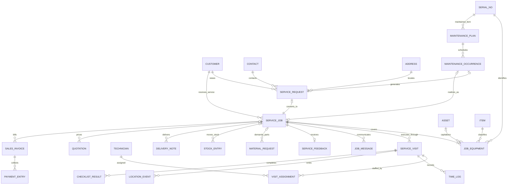

# ARCH-001 Target ERD

Status: **Proposed — approval required before schema changes**

The target uses `Service Job` as the sole operational aggregate. Request and Visit are distinct lifecycle records, not competing work orders. ERPNext owns commercial, stock, asset, and accounting records. Names marked **Proposed** are conceptual until the ADR set is approved; this document does not authorize creating them.

## Entity decisions

| Entity | Physical target | Owner | Cardinality / invariant |
|---|---|---|---|
| Service Request | Controlled evolution/rename of current Service Appointment, not a parallel duplicate | FSM Intake | Zero or one canonical Job; immutable conversion link |
| Service Job | Existing DocType | FSM Operations | Canonical aggregate root and correlation key |
| Job Equipment | **Proposed child table** | FSM Operations | One or more equipment rows per Job; links ERPNext Item/Serial No/Asset |
| Service Visit | **Proposed supporting record** | FSM Work Execution | Zero or more visits per Job; never bills or owns inventory |
| Visit Assignment | **Proposed child table** or relation owned by Visit | FSM Workforce | Supports multiple technicians without duplicating Job |
| Checklist Result | Evolution of existing Service Job Task or visit-owned result | FSM Work Execution | Execution evidence; template remains separate |
| Time Log | Existing Service Time Log, target link to Visit and Job | FSM Work Execution | Append-oriented; technician may not delete posted evidence |
| Location Event | Existing Technician Location Log | FSM Workforce | Append-only, retention-controlled, actor/device stamped |
| Maintenance Plan | **Proposed only after ERPNext overlap review** | FSM Maintenance | Recurrence definition, not an execution document |
| Maintenance Occurrence | **Proposed deterministic occurrence ledger** | FSM Maintenance | Unique `(plan, due_at)`; generates at most one request/job |
| Customer/Contact/Address | ERPNext native | ERPNext Selling | Never duplicated in FSM |
| Item/Serial No/Asset | ERPNext native | ERPNext Stock/Assets | Equipment source of truth |
| Commercial and stock documents | ERPNext native | ERPNext | Linked from Job; state is projected, never mirrored as authoritative FSM state |

## Aggregate boundaries

- Service Job owns operational priority, schedule intent, work status, equipment scope, checklist outcome, and links to supporting Visits.
- Service Visit owns a specific attendance attempt: planned/actual time, crew, GPS evidence, visit checklist execution, diagnosis, and outcome.
- Service Request owns intake, triage, consent, and conversion only.
- Maintenance Plan/Occurrence owns recurrence calculation and generation idempotency only.
- ERPNext documents own money, stock quantities, serial ownership, delivery, invoice posting, and payment allocation.

## Anti-duplication constraints

- No `Installed Base`: link ERPNext Serial No and Asset.
- No FSM invoice, payment, warehouse balance, quotation, or material request replicas.
- No Repair Order that acts as a second Service Job; depot repair is a Job type plus Visits/tasks/equipment outcomes.
- No separate Assignment aggregate when Visit/Job relations suffice.
- No separate Service Closure aggregate; closure is a guarded Job transition with immutable events.
