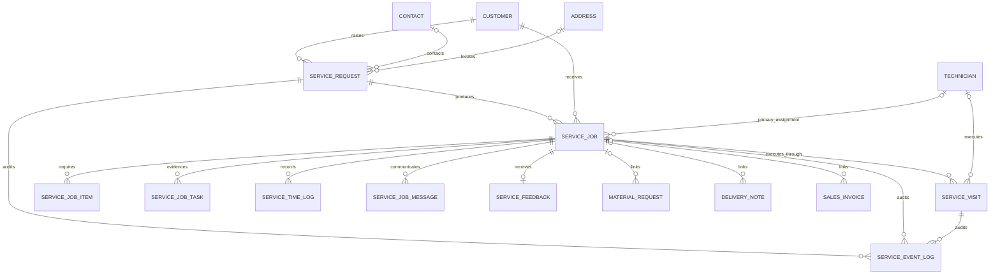

# ARCH-001 Target ERD

Status: **CORE Request/Job/Visit slice implemented; later entities remain design-only**.

## Ownership and invariants

| Entity | Physical state | Domain owner | Invariant |
|---|---|---|---|
| Service Request | Implemented rename of Service Appointment | FSM Intake | intake/triage only; `1:N` Jobs |
| Service Job | Existing and evolved | FSM Operations | sole canonical work order; `1:N` Visits |
| Service Visit | Implemented | FSM Work Execution | one attendance attempt; no billing/stock/Job completion ownership |
| Service Event Log | Implemented | FSM Operations audit | append-only correlated lifecycle evidence |
| Job task/item | Existing child tables | FSM Operations | evidence/material intent; task cannot own lifecycle |
| Customer/Contact/Address | ERPNext native | ERPNext Selling | referenced, never duplicated |
| Material/stock/commercial/accounting documents | ERPNext native | ERPNext | state linked/projected, never mirrored as authoritative FSM state |

Job Equipment, multi-technician Visit Assignment, Maintenance Plan/Occurrence, and other later-phase concepts remain design-only and are not authorized or implemented by CORE.

## Aggregate boundary

Service Request owns intake, source, contact details, problem description, triage, and conversion. Service Job owns operational priority, schedule, assigned primary technician, phase, status, checklist evidence, and ERPNext links. Service Visit owns its planned/actual timestamps, assigned primary technician, travel/check-in/work/check-out evidence, and coordinates. Event Log owns immutable history only.
