# ARCH-001 Target ERD

Status: **CORE, Installed Base, Service Teams, and Service Contracts/AMC implemented; later entities remain design-only**.

```mermaid
erDiagram
    CUSTOMER ||--o{ SERVICE_REQUEST : raises
    CONTACT o|--o{ SERVICE_REQUEST : contacts
    ADDRESS o|--o{ SERVICE_REQUEST : locates
    SERVICE_REQUEST ||--o{ SERVICE_JOB : produces
    CUSTOMER ||--o{ SERVICE_JOB : receives
    SERVICE_JOB ||--o{ SERVICE_VISIT : executes_through
    TECHNICIAN o|--o{ SERVICE_JOB : primary_assignment
    TECHNICIAN o|--o{ SERVICE_VISIT : executes
    SERVICE_REQUEST ||--o{ SERVICE_EVENT_LOG : audits
    SERVICE_JOB ||--o{ SERVICE_EVENT_LOG : audits
    SERVICE_VISIT ||--o{ SERVICE_EVENT_LOG : audits
    SERVICE_JOB ||--o{ SERVICE_JOB_ITEM : requires
    SERVICE_JOB ||--o{ SERVICE_JOB_TASK : evidences
    SERVICE_JOB ||--o{ SERVICE_TIME_LOG : records
    SERVICE_JOB ||--o{ SERVICE_JOB_MESSAGE : communicates
    SERVICE_JOB ||--o| SERVICE_FEEDBACK : receives
    SERVICE_JOB o|--o{ MATERIAL_REQUEST : links
    SERVICE_JOB o|--o{ DELIVERY_NOTE : links
    SERVICE_JOB o|--o{ SALES_INVOICE : links
    CUSTOMER ||--o{ CUSTOMER_SITE : owns
    ADDRESS o|--o{ CUSTOMER_SITE : locates
    CONTACT o|--o{ CUSTOMER_SITE : contacts
    CUSTOMER_SITE ||--o{ EQUIPMENT_LOCATION : contains
    EQUIPMENT_LOCATION o|--o{ EQUIPMENT_LOCATION : parent
    ITEM ||--o{ INSTALLED_EQUIPMENT : defines
    SERIAL_NO o|--o| INSTALLED_EQUIPMENT : tracks
    BATCH o|--o{ INSTALLED_EQUIPMENT : tracks
    DELIVERY_NOTE ||--o{ INSTALLED_EQUIPMENT : provisions
    CUSTOMER_SITE o|--o{ INSTALLED_EQUIPMENT : hosts
    EQUIPMENT_LOCATION o|--o{ INSTALLED_EQUIPMENT : locates
    SERVICE_JOB ||--o{ SERVICE_JOB_EQUIPMENT : scopes
    INSTALLED_EQUIPMENT ||--o{ SERVICE_JOB_EQUIPMENT : serviced_in
    INSTALLED_EQUIPMENT ||--o{ SERVICE_EVENT_LOG : audits
    CUSTOMER ||--o{ SERVICE_CONTRACT : owns
    SERVICE_CONTRACT ||--o{ SERVICE_CONTRACT_EQUIPMENT : scopes
    CUSTOMER_SITE ||--o{ SERVICE_CONTRACT_EQUIPMENT : covered_at
    INSTALLED_EQUIPMENT o|--o{ SERVICE_CONTRACT_EQUIPMENT : covered_asset
    SERVICE_CONTRACT ||--o{ SERVICE_CONTRACT_COVERAGE_RULE : defines
    SERVICE_CONTRACT ||--o{ SERVICE_CONTRACT_ENTITLEMENT : grants
    SERVICE_CONTRACT ||--o{ SERVICE_ENTITLEMENT_CONSUMPTION : consumes
    SERVICE_JOB o|--o{ SERVICE_ENTITLEMENT_CONSUMPTION : consumes_for
    SERVICE_CONTRACT o|--o{ SERVICE_JOB : classifies
    QUOTATION o|--o{ SERVICE_CONTRACT : commercial_reference
    SALES_ORDER o|--o{ SERVICE_CONTRACT : commercial_reference
    SALES_INVOICE o|--o{ SERVICE_CONTRACT : commercial_reference
```

## Ownership and invariants

| Entity | Physical state | Domain owner | Invariant |
|---|---|---|---|
| Service Request | Implemented rename of Service Appointment | FSM Intake | intake/triage only; `1:N` Jobs |
| Service Job | Existing and evolved | FSM Operations | sole canonical work order; `1:N` Visits |
| Service Visit | Implemented | FSM Work Execution | one attendance attempt; no billing/stock/Job completion ownership |
| Service Event Log | Implemented | FSM Operations audit | append-only correlated lifecycle evidence |
| Job task/item | Existing child tables | FSM Operations | evidence/material intent; task cannot own lifecycle |
| Customer/Contact/Address | ERPNext native | ERPNext Selling | referenced, never duplicated |
| Material/stock/commercial/accounting documents | ERPNext native | ERPNext | state linked/projected, never mirrored as authoritative FSM state |
| Customer Site | Implemented | FSM Installed Base | operational service location; ERPNext Customer/Address/Contact remain masters |
| Equipment Location | Implemented | FSM Installed Base | optional hierarchy within exactly one Site |
| Installed Equipment | Implemented | FSM Installed Base | after-sales identity and lifecycle; ERPNext Item/Serial/Batch remain masters |
| Service Job Equipment | Implemented child table | FSM Operations | N equipment per Job; snapshot fields do not replace the equipment root |
| Service Contract | Implemented | FSM Contracts | owns service period, scope, coverage terms and entitlement policy; never billing truth |
| Service Contract Equipment | Implemented child table | FSM Contracts | optional Site/equipment/category scope; references Installed Base only |
| Service Contract Coverage Rule | Implemented child table | FSM Contracts | deterministic operational coverage classification |
| Service Contract Entitlement | Implemented child table | FSM Contracts | included/used/remaining operational allowance |
| Service Entitlement Consumption | Implemented append-only ledger | FSM Contracts | unique retry key prevents double consumption; no accounting or stock state |

Maintenance Plan/Occurrence and other later-phase concepts remain design-only. Job Equipment, Service Teams,
and AMC/Service Contracts are implemented.

## Aggregate boundary

Service Request owns intake, source, contact details, problem description, triage, and conversion. Service Job owns operational priority, schedule, assigned primary technician, phase, status, checklist evidence, and ERPNext links. Service Visit owns its planned/actual timestamps, assigned primary technician, travel/check-in/work/check-out evidence, and coordinates. Event Log owns immutable history only.
