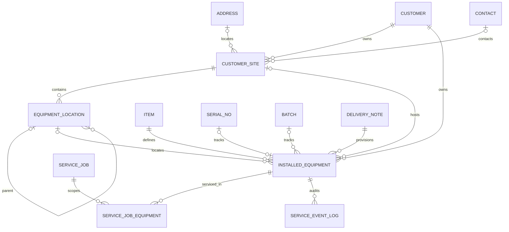

# Installed Base data model

Status: implemented for IB-001–IB-012. ERPNext v16 remains the master for Customer, Contact, Address, Item, Serial No, Batch, sales, delivery, stock, invoice and payment data.

## FSM-owned records

| Record | Kind | Identity and boundary |
|---|---|---|
| Customer Site | root DocType | `site_code` is unique; belongs to one ERPNext Customer and Company; optional same-customer parent hierarchy |
| Equipment Location | root DocType | extensible Building/Floor/Zone/Room/Area hierarchy inside one Customer Site; hierarchy is optional |
| Installed Equipment | root DocType | `FSM-EQ-.######`; unique non-sensitive QR token, provisioning key and Serial No; lifecycle is command-owned |
| Service Job Equipment | child table | N equipment rows per Service Job; snapshots site/location/item/serial/status while the equipment link remains canonical |
| Service Event Log | append-only projection | re-used with `installed_equipment` correlation; no duplicate Equipment History table |

## Invariants

- No FSM Customer, Item, Serial No, invoice or stock ledger exists.
- Site, location, equipment, Request and Job customer/company relationships must agree.
- ERPNext Serial No must exist and match the Item. The database and controller reject duplicate registration.
- Aggregate quantity is stored only for `Quantity` tracking; `Unit` creates one equipment record per whole unit.
- Terminal equipment (`Returned`, `Replaced`, `Disposed`) cannot enter a new Job.
- Equipment used by a Job cannot be deleted.

PM, AMC, recurrence, refill, inspection and workshop fields are intentionally absent.
